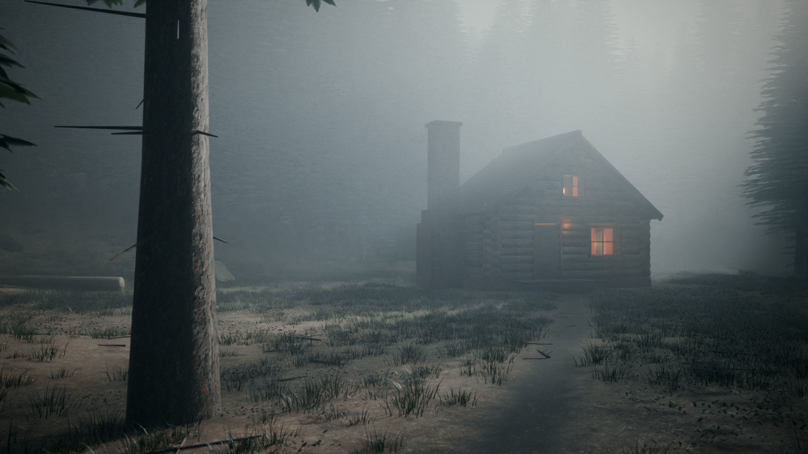
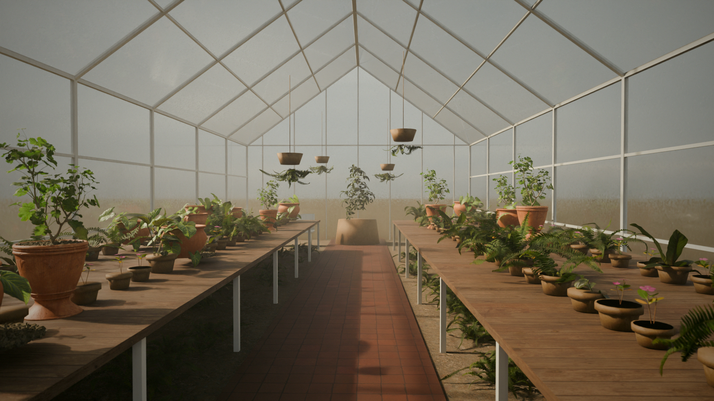
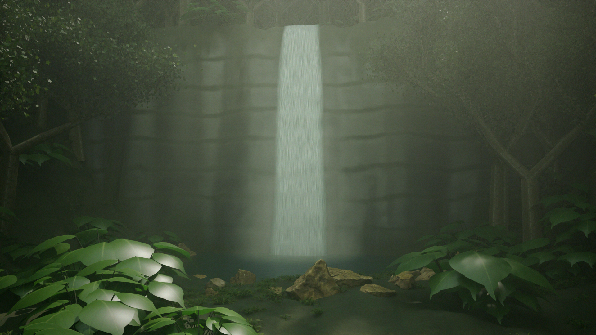

# easyscene

**一句话 → 写实、有电影感的 3D 场景（Blender）。不挑模型：DeepSeek、Kimi、GPT、Claude 都能出好图。**
**One sentence → a realistic, cinematic 3D scene rendered in Blender. Works with any AI model — DeepSeek, Kimi, GPT, Claude.**

| | | |
|---|---|---|
|  雾气森林小木屋 · Foggy forest cabin |  海边灯塔 · Coastal lighthouse |  湖边秋日码头 · Autumn lakeside dock |
|  温室花房 · Greenhouse |  雨林瀑布 · Rainforest waterfall | 即将推出：沙漠星空营地、雪山木屋 · Coming soon |

在线展示页 / Showcase page: `site/index.html`

---

## 中文

### 它是什么
一个给 Claude Code / Codex 等 AI 编程助手用的 skill。你说一句话，比如"清晨森林里有座小木屋，起雾了，窗户亮着暖光"，AI 把它翻译成一份**场景说明书**（JSON），代码负责建模、布光、材质、构图、渲染、后期。

核心理念：**把"做得好"需要的判断写进代码和配方卡里，AI 只做选择题。** 所以**不挑模型**：不需要最强、最贵的 AI，DeepSeek、Kimi 这类日常模型也能做出同样好的 3D 场景；也不用花钱调用 AI 生成 3D 模型，素材全部免费。

### 特点
- **5 种写实风格**，每种都有配方卡、标准参考图、常见错误清单
- **结果不重复**：配方里的参数是"安全范围"，换一个种子就是另一个场景（树、地形、配色、光的方向都会变），同一个种子结果一致
- **运镜预设**：云雾下降、环绕展示、贴水面飞行（共用路线、缓动、避障代码）
- **细节**：说"门廊上放一把摇椅"，就会真的放上去；库里没有的东西会如实说明
- **自动检查**：悬空、穿模、缺贴图、主体是否在画面里、过暗过曝、主体占比
- **AI 评审**：按配方卡评分标准打分，不及格自动给出改法
- **素材全部 CC0**（Poly Haven），自动下载缓存并生成许可清单；断网也能用程序化材质出图

### 安装
1. 安装 [Blender 5.2](https://www.blender.org/download/)、Python 3.9+、[ffmpeg](https://ffmpeg.org/)（用于后期和视频）
2. 下载本仓库，把文件夹放到你的 skills 目录（Claude Code：`~/.claude/skills/easyscene`）
3. 可选：预先下载素材 `python3 -m easyscene.assets foggy_forest_cabin`

### 示例提示词
- 清晨森林里有座小木屋，起雾了，窗户亮着暖光，用云雾下降开场，10 秒
- 日落时海边悬崖上的灯塔，镜头绕着灯塔转
- 秋天湖边的木码头，红叶倒映在湖面上，竖屏
- 清晨的老式玻璃温室，两边摆满盆栽
- 热带雨林深处的瀑布，阳光从树冠缝隙照下来
- 雾气森林小木屋，门廊上有一把摇椅和一盏提灯，换一个种子再来一张

### 自己做风格
见 [`docs/RECIPE_GUIDE.md`](docs/RECIPE_GUIDE.md)（格式说明、空白模板、完整示例）。

### 素材许可
所有第三方素材来自 [Poly Haven](https://polyhaven.com)，许可为 **CC0**（公有领域，可商用、无需署名）。每次渲染都会在输出目录生成 `ASSET_LICENSES.md`，列出用到的每个素材、作者和链接。其余一切（树、木屋、灯塔、水面、雾、烟……）都是程序化生成的原创内容。

### 开源协议
代码：Apache-2.0。

---

## English

### What it is
A skill for AI coding agents (Claude Code, Codex, …). The user says one sentence; the agent fills in a JSON **scene spec**; tested code does the modelling, lighting, materials, composition, rendering and grading. The agent never writes Blender code — it only makes choices, so **it works with any model**: everyday models like DeepSeek or Kimi get the same quality as the strongest ones, and there are no paid 3D-generation calls.

### Features
- **5 realistic styles**, each with a recipe card, reference render and a common-mistakes list
- **Never the same twice**: recipe values are safe *ranges*; a new seed gives a new scene; the same seed reproduces it
- **Camera moves**: cloud descent, orbit, water skim (shared route / easing / obstacle-avoidance code)
- **Details**: "a rocking chair on the porch" is actually placed; unavailable items are reported honestly
- **Automatic checks**: floating parts, clipping, missing textures, subject in frame, exposure, subject size
- **AI review**: rubric scoring from the recipe card, with concrete spec fixes when it fails
- **All assets CC0** (Poly Haven), cached with an automatic license manifest; procedural fallback offline

### Install
1. Install [Blender 5.2](https://www.blender.org/download/), Python 3.9+, [ffmpeg](https://ffmpeg.org/)
2. Put this folder in your skills directory (Claude Code: `~/.claude/skills/easyscene`)
3. Optional: prefetch assets `python3 -m easyscene.assets foggy_forest_cabin`

### Example prompts
- A small cabin in a misty forest at dawn, warm light in the windows, open with a cloud descent, 10 seconds
- A lighthouse on a sea cliff at sunset, the camera orbits it
- A wooden dock on an autumn lake with red leaves reflected, vertical video
- An old glasshouse in the morning, full of potted plants
- A jungle waterfall with sunbeams through the canopy

### Make your own style
See [`docs/RECIPE_GUIDE.md`](docs/RECIPE_GUIDE.md).

### Asset licenses
Third-party assets come from [Poly Haven](https://polyhaven.com) under **CC0** (public domain, commercial use, no attribution required). Every render writes `ASSET_LICENSES.md` listing each asset, its authors and source. Everything else is procedurally generated.

### License
Code: Apache-2.0.
